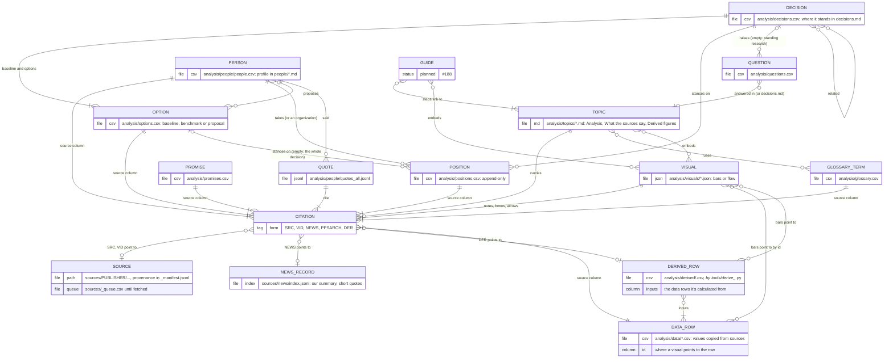

# Research approach

How this archive decides what to research, how the research is organized, and how we tell useful analysis from
analysis for its own sake. `CLAUDE.md` says how to do the work, `RUNBOOK.md` how to add sources, and `adr/` why
the repo is built the way it is.

## In one paragraph

The research starts from **decisions**: choices someone will make by a date, such as the Governor's budget or a
draw on the Education Stability Fund. Each decision has a **baseline** (what happens if nothing changes) and
**options** on the table, and the people involved take **positions** on them. Comparing the options fairly raises
**questions**, and the questions drive the research. The **evidence** (sources, figures, topics, profiles) is what
answers them. An analysis is worth doing when it helps a reader understand the options before the decision is made,
or understand afterwards what was decided and what it bought.

## Who it's for

The realistic readers are Oregon public school parents and the volunteers who contribute. We write to a reporter's
standard anyway: every figure has a source, a baseline and a date, and the framing would survive a skeptical
reader who disagrees with us. The maintainers are public school parents, and the About page says so.

What a reader needs is a **cited answer they can lift**: a sentence with the number, its baseline, its main caveat
and its source, and a link to the depth behind it.

## Neutral by design

This is a data warehouse, not a campaign site (`CLAUDE.md`). The decision model makes it easy to drift into
advocacy, because options come from people who want something. So:

- **Every decision has a baseline row** (no action, the current service level, or the budget that's in force), and
  the comparison is always against it.
- **Every option gets the same treatment**: the strongest case made for it and against it on the record, the same
  questions asked of it, and its formality (law, bill, budget line, formal request, statement, social post).
- **Options come from everyone involved**, including official analysts (Legislative Fiscal Office, Legislative
  Revenue Office, Quality Education Commission) and the revenue side, not only from those asking for money. At each
  review we ask who's missing.
- **Benchmarks are labelled as benchmarks.** The Quality Education Model is the state's own estimate of what schools
  need, and it is contested: the Legislature's education funding committee criticizes its method, and some
  legislators want to replace it. Figures are shown as a comparison set (current service level, the adopted
  2025-27 amount, the Governor's budget, the status quo and full Quality Education Model), each with who calculated
  it and when.
- **Promises are rated on outcomes** (what was funded, enacted or voted), with interim and final ratings. Positions
  are recorded, not rated.

## The model

```
decision ── baseline and options ── positions (who stands where, when)
    │
    └── questions (what a reader needs to know to compare the options)
               │
            evidence (sources, data, derived figures, topics, people profiles, quotes)
```

| Entity | What it is | Example | Where it lives |
|---|---|---|---|
| Decision | A choice, who makes it, by when, its status and outcome | Draw on the Education Stability Fund in 2027-29? | `analysis/decisions.csv` |
| Option | The baseline, a benchmark or a concrete proposal, who proposed it, its formality | PPS: $500M to buy down PERS rates statewide | `analysis/options.csv` |
| Position | One actor's dated, cited stance on a decision or an option | Lieber, May 2026: warned that one-time money for ongoing costs leaves a cliff | `analysis/positions.csv` |
| Actor | A person or body with a role in a decision | Sen. Kate Lieber, Ways and Means co-chair | `analysis/people/people.csv`; `analysis/people/<id>.md` |
| Question | What a reader needs to know to compare options | Could the stability fund pay down districts' PERS costs? | `analysis/questions.csv` |
| Evidence | What sources say, what we calculated, our analysis | Fund rules, balances, PERS rates | `sources/`, `analysis/data/`, `analysis/derived/`, `analysis/topics/`, `analysis/people/` |

### The whole repo

How every kind of file relates. Citations are the links from what we write to what sources say; the site turns
each one into a chip. Guides (#188) are planned. Keep this diagram current: a new file type or relationship means
editing it (`CLAUDE.md`, "Before writing").



**Topics are evidence, organized by subject** (the Education Stability Fund, the Quality Education Model, the
formula, Measures 5 and 50). They keep their three sections and grow slowly. **People profiles are evidence,
organized by person**: what someone has said and done, dated and cited, with their quotes in `quotes_all.jsonl`.
Facts live in one place: a fact lands in a topic, profile or data table first, and a position, option or answer
cites the same source.

### `decisions.csv`

`id, decision, decided_by, due, status, related, outcome, outcome_source, source`

- `id`: a short slug, e.g. `esf-draw-2027-29`, used by the other files and in issues as `Serves: <id>`.
- `decided_by`: anyone who decides, not only the state (school boards, voters).
- `status`: `open`, `decided` (with `outcome` and `outcome_source`) or `implemented` (the money or law is in
  effect; research on what it bought continues).
- `related`: ids of decisions this one changes or depends on (a reserve draw changes the State School Fund amount).

### `options.csv`

`id, decision, kind, option, proposed_by, proposed_on, amount, formality, source`

- `kind`: `baseline` (at least one per decision), `benchmark` (an estimate to compare against, such as the full
  Quality Education Model) or `proposal`.
- `amount`: as the proposer states it, with its unit, or empty.

### `positions.csv`

`decision, option, actor, date, stance, source, replaces`

One row per stance, appended, never edited. To correct a wrong row, append the corrected row with `replaces` set to
the line number of the row it replaces (header = line 1); the site shows only the newest version
(`adr/20261122-1718-correcting-append-only-rows.md`). `option` is empty for a stance on the decision as a whole.
`actor` is a `people.csv` id or an organization's name. `date` is when the stance was stated or reported. `stance`
can be `none stated` when someone was asked and declined. Only stances on the record.

### `questions.csv`

`id, question, decision, criterion, asked_by, needed_by, status, answer, issue`

- `asked_by` describes the asker ("a parent volunteer", "the maintainer"), never a member of the public's name.
- `status`: `open`, `answered` (with `answer`: a link to the section of `analysis/decisions.md` or a topic that
  answers it) or `not planned` (closed by the maintainer, with what was found so far in `answer`).
- `issue`: the GitHub issue that does the work, if any. The CSV is the record; issues are work tickets.

Readers can send questions by email; the maintainer adds them here.

## Choosing what to work on

There are two tracks.

**Decision research** serves an open decision. An issue gets `next` when it passes these checks:

1. It serves a decision that's still open (`Serves: <id>` in the issue body), and can land before its due date.
2. It helps a reader understand the options, on any criterion that matters: cost, one-time vs ongoing, who
   qualifies, fairness between districts, results. Not only the criteria the deciders use.
3. Its answer isn't settled already. Before `next`, the issue says what range of answers we expect and what would
   differ across that range. If every answer reads the same, it's background, not research.
4. Nobody official already answers it plainly. If an agency does, archive that document and link to it.
5. It's targeted: it answers one decision's question, or a few closely related ones, in one PR a reviewer can check
   in one pass. Scope is set here, by the maintainer, not by runs: a run that finds an issue too broad proposes a narrower
   scope on the issue and moves on; it doesn't split it.
6. Every checklist item has a source that exists today. An item that waits for a future document (the Governor's
   budget, the next forecast, a session's adopted budget) goes in its own issue labelled `blocked`, with a
   `Waits for: <document>, expected <date>` line; it gets `next` once the document is archived. The same check
   applies to items added in comments after an issue is labelled `next`, and runs move such items out (skill step 2).

**Standing research** has no due date: what the money bought (results, the Student Investment Account, SB 141
accountability), how the formula works, and history such as Measures 5 and 50. It's labelled `standing` and
competes for `next` on how much it would change a reader's understanding, not on a date. It also covers decisions
that are `decided` or `implemented`: what happened afterwards is what the promise ratings rest on.

Housekeeping and tooling issues need neither, but shouldn't crowd out research near a due date. They're labelled
`enhancement` (research issues are labelled `research`) and ordered in their own Enhancements queue (label
`enhancement-queue`), which the nightly run doesn't work.

`next` means an issue is ready; the **Research queue** issue (label `queue`) sets the order. The maintainer adds `next`
issues to it in the order they should run, and agents take the first free one.

**Where questions come from**, in order of weight:

1. **Readers.** "What would you most want to know before talking to a legislator or your school board?"
2. **The options on the table.** What would you need to know to compare them, for and against?
3. **Objections on record.** Each argument made for or against an option, by anyone, is a question to check.
4. **Promises and gaps.** What's been pledged, and what the archive can't answer yet.

## What readers see

| Page | Built from | Job |
|---|---|---|
| Start here (the home page) | `analysis/START.md` | What's being decided now, the comparison set of key numbers, where to go next |
| What's being decided | `decisions.csv`, `options.csv`, `positions.csv`, `questions.csv`, `analysis/decisions.md` | Per decision: who decides and by when, the baseline and options, who stands where and when, what's known, open questions |
| Topics | `analysis/topics/*.md` | The evidence on one subject |
| People, What they've said, Promises, The numbers, Timeline, Glossary, Sources | as named | Reference |
| Charts and diagrams (`/visuals/`), each with its own page | `analysis/visuals/*.json` | Show a comparison or a flow at a glance, embedded in any page; each visual's page gives its text version, notes and sources |
| About | `website/about.md` | Who runs the site, how to read it, how to send a question |

`analysis/decisions.md` holds the hand-written part of the decisions page: one section per decision with a short
"where it stands" and the answers to questions, cited like any analysis. The tables come from the CSVs.

## Writing so it gets used

Wording rules (voice, verdict words, numbers, names, dates) are in `STYLE.md`; the clarity reviewer checks them.

- **Answer first.** Lead with the answer, then the support (Pyramid Principle, bottom line up front).
- **Always state the baseline**, and which benchmark a gap is measured against. A gap means nothing without its
  reference point.
- **A liftable sentence carries its number, baseline, main caveat and source**, so it survives being pasted alone.
  It links to the depth; it doesn't replace it.
- **Say what it means as if/then**, in an "Analysis:" passage: "If the State School Fund lands at the current
  service level, then ...".
- **Use the language of comparing options**, not of asks: "objections on record", not "pushback"; "this option needs
  a three-fifths vote", not "a weaker ask".
- **Write for an intelligent reader who doesn't know the field.** Plain words, the active voice, terms defined in
  the text the first time they appear on a page (the glossary tooltips don't work on phones).

## How we know it's working

Review at each due date: Dec 1, session start, each revenue forecast, and the end of the session. These are for
steering, **not targets**: a measure chased as a target stops measuring anything.

| Measure | What good looks like |
|---|---|
| Questions answered in time | Most `open` questions answered before `needed_by`; `not planned` closures counted separately |
| Decisions covered | Each open decision has its baseline, options and stated positions recorded before its due date |
| Corrections | Few errors found after merge, counted per claim (each one becomes an `escaped-error` issue) |

`python3 tools/check_citations.py --measures` prints the first two. Use is noted when a reader tells us; there's no
counter for it.

## Practices this draws on

| Practice | What we take from it |
|---|---|
| Decision-driven analytics ([De Langhe and Puntoni](https://www.esade.edu/en/articles/leading-decision-driven-data-analytics)) | Start from the decision and work back to the data, not from the data we happen to have |
| Value of information ([explainer, Resources for the Future](https://www.rff.org/publications/explainers/value-of-science-105-three-principles-of-the-value-of-information/)) | Research is worth doing when its answer isn't already settled |
| [Our World in Data's topic and metric criteria](https://ourworldindata.org/choosing-our-topics-and-metrics) | Written selection criteria; measures that are easy for non-experts and hard to misuse |
| Pyramid Principle and SCQA ([Barbara Minto](https://lethain.com/pyramid-principle/)); bottom line up front | Answer first, support underneath |
| Policy brief guidance ([UVM Gund Institute](https://www.uvm.edu/sites/default/files/Gund-Institute-for-Environment/Gund_Guidance_for_Writing_Policy_Briefs_2020.pdf), [Politico Pro template](https://www.politicopro.com/guides-tools/politico-pro-policy-brief-template.pdf)) | If/then implications, written for an intelligent but uninformed reader |
| [PolitiFact promise ratings](https://www.politifact.com/truth-o-meter/promises/biden-promise-tracker) | Rate promises on verifiable outcomes, with interim and final ratings |
| [Education Law Center, Making the Grade](https://edlawcenter.org/research/making-the-grade/) | Comparisons need stated benchmarks; a national report card can only compare states |
| [Goodhart's law](https://en.wikipedia.org/wiki/Goodhart%27s_law) | Measures for review, not targets |

## How the repo supports the research

None of this is research. It keeps the evidence trustworthy, publishes it and helps people use it; a part that
stops doing one of those jobs should go.

- **Site build** (`site-11ty/`, Eleventy, and `website/about.md`): turns `analysis/` and `sources/` into the reader
  pages above, with citations as links, a preview card for every linked person, topic, document and abbreviation,
  and site search.
- **Workflows** (`.github/workflows/`): `fetch-sources` archives queued documents with provenance and OCR,
  `transcribe` writes machine transcripts for media, `check` blocks a merge when citations, derived figures or the
  What's new row are wrong, and `pages` publishes the site.
- **Tools** (`tools/`): stdlib scripts that search and read the archive (`search`, `doc`, `linkify`), fetch it
  (`fetch_sources`, `ocr_pdfs`), check it (`check_citations`, `check_sources`, `test_tools`) and calculate it
  (`derive_<topic>`, one per topic).
- **Skills** (`.claude/plugins/fund-oregon-schools/`): `fos-research` answers from the archive with citations;
  `fos-work-issue` takes an issue to a reviewed PR, with an independent fact-check and fairness review;
  `fos-lead` turns a lead into vetted, archived sources and drafted issues, with the maintainer.
- **Volunteer setup** (`SETUP.md`, `setup/`): gets a volunteer's own Claude answering from the archive, read only.
- **ADRs** (`adr/`): why the repo is built the way it is, and when to revisit.
- **Runbook** (`RUNBOOK.md`): how to add and refresh sources.
- **CLAUDE.md**: the rules every agent follows: citation formats, keeping sources, derived figures and analysis
  apart, quotes verbatim.
- **What's new** (`analysis/updates.csv`): one reader-facing line per change, marked research, correction or site. The maintainers' history is the PRs
  and git.
